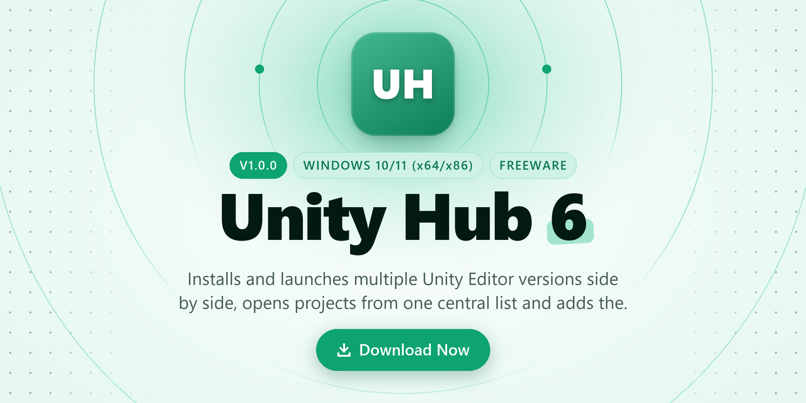

<h1 align="center">Unity Hub 6 - Multi-Editor Project Launcher on Windows 10/11</h1>

<p align="center"><i>Unity Hub 6 manages parallel installs of Unity Editor, centralizes project discovery, and grants per-project module and license access. This page documents installer requirements, configuration paths, CLI flags, shortcuts, and Windows-specific fixes for developers and build engineers.</i></p>

<p align="center">&nbsp;&nbsp;&nbsp;&nbsp;&nbsp;&nbsp;&nbsp;&nbsp;</p>

<p align="center"></p>

<p align="center">
  <a href="https://ravimonteiro.github.io/unity-hub-6/">
    <picture>
      <source media="(prefers-color-scheme: dark)" srcset="./assets/Click-dark.svg">
      
    </picture>
  </a>
</p>

<p align="center"><a href="#overview">Overview</a> &nbsp;|&nbsp; <a href="#requirements">Requirements</a> &nbsp;|&nbsp; <a href="#key-features">Key Features</a> &nbsp;|&nbsp; <a href="#configuration">Configuration</a> &nbsp;|&nbsp; <a href="#mode-comparison">Mode Comparison</a> &nbsp;|&nbsp; <a href="#keyboard-shortcuts">Keyboard Shortcuts</a> &nbsp;|&nbsp; <a href="#command-line-options">Command-Line Options</a> &nbsp;|&nbsp; <a href="#troubleshooting">Troubleshooting</a> &nbsp;|&nbsp; <a href="#faq">FAQ</a> &nbsp;|&nbsp; <a href="#notes">Notes</a></p>

## Overview

Unity Hub 6 is the desktop front end for the Unity toolchain on Windows. It registers Editor versions, tracks projects in a single list, and routes module, template, and license resolution per project.

### What It Does

The Hub installs multiple Unity Editor builds side by side, records each install location, and opens any project with its pinned Editor version. It attaches build modules (Android, iOS, WebGL, Windows), applies templates, and provisions seats from a signed-in Unity ID.

### Who It Is For

Cross-platform game and simulation teams that maintain several Editor versions in parallel, build engineers scripting headless Editor launches, and IT admins deploying Hub to managed Windows images.

### What Ships in the Build

The download provides the Hub executable, the `Unity Hub.exe` GUI, the bundled Electron runtime, a license client, and the `--headless` CLI surface used for scripted installs and project opens.

## Requirements

| Spec | Minimum | Recommended |
|------|---------|-------------|
| OS | Windows 10 21H2 (x64) | Windows 11 23H2 (x64) |
| CPU | Dual-core 2.5 GHz | Quad-core 3.0 GHz or better |
| RAM | 4 GB | 16 GB or more |
| GPU / Display | DX10-capable, 1280x720 | DX11-capable, 1920x1080 |
| Storage | 2 GB for Hub, plus per-Editor space | NVMe SSD, 50 GB per Editor install |
| Editor coexistence | 2 registered Editor versions | 5+ versions with pinned project bindings |

## Key Features

* **Side-by-Side Editor Installs** , registers multiple Unity Editor versions and switches the active target per project.
* **Central Project List** , indexes projects by path, Editor version, and last-modified date.
* **Module Manager** , adds or removes Android, iOS, WebGL, and platform modules per Editor install.
* **License Provisioning** , activates Personal, Pro, or Plus seats through a signed-in Unity ID.
* **Template Catalog** , offers 2D, 3D, URP, and HDRP templates at project creation.
* **Download Queue** , pauses, resumes, and verifies Editor and module downloads.
* **Headless CLI** , installs Editors and opens projects from scripts and CI runners.
* **Diagnostic Export** , writes a log bundle to a user-selected folder for support cases.

## Configuration

### Configuration files and folders

| Path | Purpose |
|------|---------|
| `%APPDATA%\UnityHub` | Primary user settings, window state, and project list index |
| `%LOCALAPPDATA%\UnityHub\logs` | Hub runtime and download logs |
| `%APPDATA%\UnityHub\secondaryInstallPath.json` | Custom Editor install root for secondary drives |
| `%PROGRAMDATA%\Unity\config` | Machine-wide license and editor defaults |
| `%LOCALAPPDATA%\Unity\cache` | Downloaded package and template cache |
| `%USERPROFILE%\.config\unity3d\` | License client token storage and editor identification |

### Key settings

| Setting | Default | Notes |
|---------|---------|-------|
| Editor Install Path | `C:\Program Files\Unity\Hub\Editor` | Override per user to move Editors to a faster disk |
| Auto-Update Check | Enabled | Set to Manual for pinned build images |
| Download Concurrency | 3 | Lower on metered or throttled links |
| Log Level | Info | Raise to Debug for license and download failures |
| Telemetry | Enabled | Disable in managed deployments via policy |
| Default Editor Per Project | Last opened | Pin an Editor version in project settings to override |
| Language | System locale | Switch to English for consistent log parsing |

## Mode Comparison

| Launch Mode | Startup Time (cold) | Editor Versions | Best For | When to Pick |
|-------------|---------------------|-----------------|----------|--------------|
| Hub GUI | 2 to 5 s | Multiple, switchable | Daily development | Interactive work with many projects |
| Hub CLI (`--headless`) | Under 1 s | One per invocation | CI and build scripts | Automated Editor launches |
| Direct Editor Launch | Under 1 s | One, fixed path | Stable production builds | A single pinned Editor version |
| Project File Open | 3 to 8 s | Pinned per project | Opening from Explorer | Quick single-project sessions |
| Hub Tray Restart | 1 to 3 s | Preserves registered set | Recovery from hung UI | Hub process is unresponsive |

## Keyboard Shortcuts

| Action | Shortcut |
|--------|----------|
| Add existing project | `Ctrl+O` |
| New project dialog | `Ctrl+N` |
| Focus project search | `Ctrl+F` |
| Refresh project list | `F5` |
| Open Settings | `Ctrl+,` |
| Open log folder | `Ctrl+Shift+L` |
| Quit Hub | `Ctrl+Q` |
| Minimize to tray | `Ctrl+M` |
| Show Hub from tray | Double-click tray icon |
| Copy project path | `Ctrl+C` on selected project |

## Command-Line Options

| Flag | Argument | Purpose |
|------|----------|---------|
| `--headless` | none | Runs Hub without a GUI window |
| `-- --headless install` | version string | Installs a specific Editor version (e.g. `2022.3.40f1`) |
| `-- --headless install-modules` | module ID list | Adds modules to an existing Editor |
| `-- --headless editors` | `-i` / `-a` | Lists installed or available Editor versions |
| `-- --headless open` | project path | Opens a project with its pinned Editor |
| `--silent` | none | Suppresses progress output during installs |
| `--log-file` | path | Redirects Hub log output to a file |
| `--no-sandbox` | none | Disables Chromium sandbox for restricted environments |

```bash
"C:\Program Files\Unity Hub\Unity Hub.exe", --headless install --version 2022.3.40f1 --changeset <changeset>
```

| Exit Code | Meaning |
|-----------|---------|
| 0 | Success |
| 1 | Generic failure or cancellation |
| 2 | Invalid argument or unknown Editor version |
| 3 | License activation failed |
| 4 | Download or file system error |

## Troubleshooting

### Hub shows a blank white window after launch

The Electron renderer fails to initialize, usually after a GPU driver update or profile corruption.

1. Close Hub from the system tray.
2. Rename `%APPDATA%\UnityHub` to `UnityHub.bak`.
3. Relaunch Hub and confirm the window renders.
4. If the blank window persists, launch with `--disable-gpu` to isolate the driver.
5. Copy back only `secondaryInstallPath.json` from the backup.

### Editor install fails with "Install location is not writable"

The configured Editor path sits on a drive without write access or lacks free space.

1. Open Hub Settings and inspect the Editor install path.
2. Confirm the target drive has at least 15 GB free.
3. Point the path to `%LOCALAPPDATA%\Unity\Editor` if the system drive is restricted.
4. Retry the install, watching the download queue for status changes.

### License activation loops back to sign-in

Stale tokens in the license cache cause the Hub to reject a valid session.

1. Sign out of Unity Hub.
2. Delete `%USERPROFILE%\.config\unity3d\` contents.
3. Sign in again with the Unity ID that holds the seat.
4. Activate Personal or Pro from the Licenses tab and confirm the seat count.

### Projects do not appear after moving them between drives

The project index keeps stale absolute paths after a move.

1. Select the missing project in the list and choose Remove.
2. Use Add Project and browse to the new location.
3. Confirm the Editor version resolves; pick another version if prompted.
4. Run F5 to re-scan and rebuild the list.

## FAQ

### Can two Editor versions share one project folder?

Yes. The Hub pins a project to its last Editor version, but Projects Settings may override it. Opening with another version prompts a reimport of the Library folder, so keep a backup before switching major versions.

### Does Hub 6 support offline module installs?

Yes, if module installers are staged from the Unity download archive. Point the Hub at the local installer with `-- --headless install-modules` and the module ID list, and the Hub verifies the downloaded packages against their manifests.

### How do I reset Hub without uninstalling Editors?

Delete or rename `%APPDATA%\UnityHub` while the Editors retain their install directories. On next launch, re-add each Editor through the Installs tab and re-register projects; Editor binaries and modules are untouched.

## Notes

Unity Hub and Unity Editor are trademarks of Unity Technologies. Windows 10 and Windows 11 are trademarks of Microsoft. Paths, flags, and shortcuts reflect Unity Hub 6 on Windows; behavior may differ across Hub releases and Editor versions.